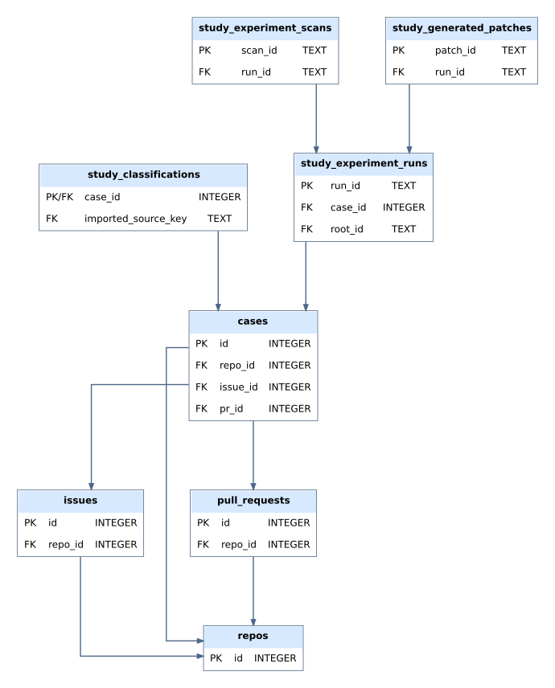

# Security findings in agent-associated pull requests

Code and analysis for an observational study of GitHub issues and pull requests associated with coding agents. The study traces scanner-reported findings in the resulting changes back to the changed operations responsible for them, and compares the affected workflows with matched controls.

**Paper:** [paper/main.pdf](paper/main.pdf)
**Dataset:** [Hugging Face](https://huggingface.co/datasets/Stralb/adversarial-swe-agents) *(private access required)* · [data guide](data/README.md)
**Database:** [full ERD](data/erd/full.svg) · [schema](data/study_schema.sql)
**Archive (DOI):** *to be added*

## Quick start

Python 3.11 or later. No GitHub token and no scanners are needed.

```bash
python3 -m venv .venv
source .venv/bin/activate
make setup
make check
```

`make check` checks Python syntax, recalculates the paired tests from the bundled aggregates, checks the recorded cohort totals, and runs the tests. It does not access GitHub, launch scanners, or modify data. A passing run prints the paired-test table and ends with `131 passed, 2 xfailed`:

```
Comparison                                 N     Effect           p        Holm
Issue purpose                            190   0.100000  0.09719257  0.68034796
Instruction specificity                  190   0.142105  0.00052012  0.00468105
Goal alignment                           190   0.121053  0.00101867  0.00814940
...
```

With Docker instead: `docker build -t checks . && docker run --rm checks`.

## Layout

| Path | Contents |
| --- | --- |
| `miner/` | ([README](miner/README.md)) The pipeline: collection, issue linking, filters, scanners, database, workers. Run with `python -m miner {init-db,collect,scan,export}` |
| `checks/` | ([README](checks/README.md)) Recomputes the paper's paired tests and bootstrap checks and verifies the cohort totals, from `data/` |
| `replay/` | The O/W/P patch replay and CodeQL comparison (RQ3) ([README](replay/README.md)) |
| `annotation/` | Prompts, coding protocols and codebooks for the annotation stages ([README](annotation/README.md)) |
| `data/` | Aggregate results, database schema and dataset guide ([README](data/README.md)) |
| `tests/` | Unit tests |
| `paper/` | Manuscript |
| `config.yml` | Collection and scanner configuration used for the study |

## Study

The population is 3,809 linked issue-to-pull-request workflows, of which 192 are scanner-positive. The matched analysis uses 190 pairs, 115 of them within the same repository. The code-change analysis records 455 producing changes in 191 workflows, grouped into 342 implementation roots. Pairs and changes are different units and are not interchangeable denominators.

Five categorical comparisons use Stuart-Maxwell marginal-homogeneity tests, three binary comparisons use exact McNemar tests, and issue-to-PR delay uses the Wilcoxon signed-rank test. Holm adjustment covers the nine primary comparisons.

| Comparison | Pairs | p | Holm p |
| --- | ---: | ---: | ---: |
| Issue purpose | 190 | 0.0972 | 0.6803 |
| Instruction specificity | 190 | 0.00052 | 0.0047 |
| PR goal alignment | 190 | 0.0010 | 0.0081 |
| Implementation category | 190 | 0.1195 | 0.7171 |
| Formal human review | 189 | 0.4188 | 1.0000 |
| Issue-to-PR delay | 190 | 0.2412 | 1.0000 |
| Same issue and PR author | 190 | 1.0000 | 1.0000 |
| Prior requester activity | 187 | 0.3356 | 1.0000 |
| Primary coding agent or tool | 190 | 0.2190 | 1.0000 |

Explicit instructions occur in 121 of 190 positive issues (63.7%) and 148 of 190 controls (77.9%); positives suggest a solution without fully specifying it in 33 cases (17.4%) against 9 controls (4.7%). The PR is aligned with the issue goal in 160 of 190 positives (84.2%) and 183 of 190 controls (96.3%).

The comparisons are observational. A scanner finding is not proof of an exploitable vulnerability or of a malicious issue, and matching does not establish causality.

## Database

The study database (111 tables, 18 views) is documented in [`data/study_schema.sql`](data/study_schema.sql). The overview below shows how its main parts connect; the [full ERD](data/erd/full.svg) shows every table.



## Reproducing the results

- `make check` recomputes the eight paired tests from `data/matched_aggregates.json` and checks the cohort totals in `data/cohort_lineage.json`. The delay result is carried from the original analysis.
- The RQ3 replay pipeline is in `replay/`.
- Every case, annotation, matched pair and replay record is in the dataset.

## Running the miner

Collection needs GitHub credentials, a writable database and installed scanners (CodeQL, Semgrep, OSV-Scanner, Trivy, Gitleaks). It writes data, so use a disposable database.

```bash
cp .env.example .env
# set GITHUB_TOKEN; inspect CONFIG and DB_PATH
make install
make collect
make scan   # or: python -m miner collect / scan / export
```

`config.yml` is the study configuration; check its scope and limits first.

## Citation

See [CITATION.cff](CITATION.cff).

## License

Code is released under the [MIT License](LICENSE).
