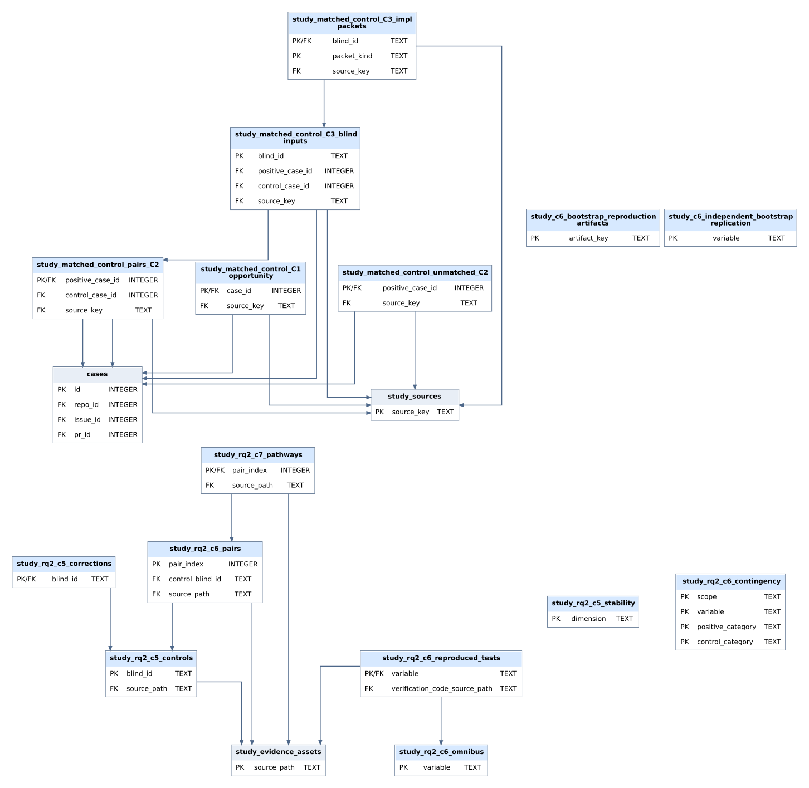

# checks

Recomputes the paper's matched-pair statistics from the aggregate tables in [`data/`](../data/README.md) and verifies the recorded cohort totals. `make check` runs these modules.

| Module | Check |
| --- | --- |
| `matched_results.py` | Five marginal-homogeneity and three exact McNemar tests from the paired tables; the delay result is read from the recorded value |
| `pathway_tables.py` | The same categorical tests from indexed counts |
| `bootstrap_checks.py` | Analytic pair-bootstrap distributions |
| `cohort_lineage.py` | Consistency of the recorded cohort and matching totals |

```bash
python -m checks.matched_results --check
```

The matched pairs and control tests are stored in these tables:


