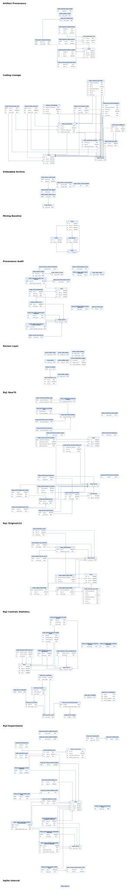

# Data

Aggregate results used by the `checks/` modules, plus documentation for the study dataset.

## Files

| File | Contents |
| --- | --- |
| `matched_aggregates.json` | Paired category matrices, discordant binary counts and the reported delay result |
| `cohort_lineage.json` | Recorded cohort and matching totals |
| `pathway_aggregates.json`, `bootstrap_reference.json` | Indexed paired counts and bootstrap references |
| `schema.sql` | Table and view layout of the study database (111 tables, 18 views) |
| `erd/` | Entity-relationship diagrams: full, overview, and the parts used by `miner/`, `replay/` and `checks/` |
| `queries.sql` | Descriptive counts per analysis unit, and a walkthrough of one case |

## Database ERD



## Study dataset

The case-level data is on [Hugging Face](https://huggingface.co/datasets/Stralb/adversarial-swe-agents) (private access required). The default configuration, `paper_cases`, has one row per issue-to-PR case with repository names, source text, URLs and cohort flags. The full SQLite database, `adversarial-swe-agents.sqlite`, is released with it; it is too large for Git.

| Data | Size |
| --- | ---: |
| Cases | 3,809 |
| Scanner-positive cases | 192 |
| Initial / later annotation cohorts | 122 / 70 |
| Cases with mapped changes | 191 |
| Producing changes | 455 |
| Implementation roots | 342 |
| Matched pairs | 190 |
| Replay runs | 40 across 14 cases (12 complete O/W/P triples) |

The ten Parquet configurations keep cases, positive cases, changes, roots, pairs, annotations, findings, replay runs and artifacts as separate analysis units.

```python
from datasets import load_dataset

cases = load_dataset(
    "Stralb/adversarial-swe-agents",
    split="train",
    revision="e71e8b39ed56ffb1c2198b9df2384495b8404317",
    token=True,
)
```

The `train` split is a storage convention, not a training/evaluation allocation.
