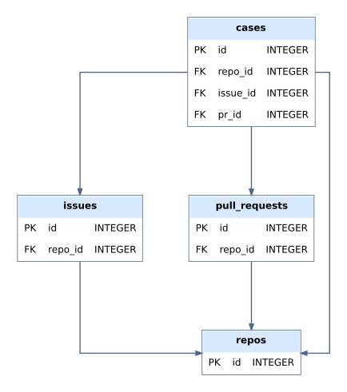

# miner

Collects merged, issue-linked, agent-associated pull requests from GitHub and runs the analysis tools on them.

```bash
python -m miner init-db   # create or update the database
python -m miner collect   # find and store cases
python -m miner scan      # run the analysis tools on stored cases
python -m miner export    # write the case table
```

| Package | Role |
| --- | --- |
| `github/` | API client, rate limits, issue linking |
| `pipeline/` | Collection, case building, scanning and export |
| `filters/` | Pull request, issue and bot filters; analysis-tool applicability |
| `markers/` | Agent-association markers |
| `scanners/` | CodeQL, Semgrep, OSV, Trivy, Gitleaks and the dependency diff |
| `artifacts/` | File type and region mapping |
| `workers/` | Analysis job queue |
| `db/` | SQLite access and schema |

Cases are stored in these tables:



Configuration is read from `config.yml`; set `GITHUB_TOKEN` and `DB_PATH` in `.env` (see `.env.example`).
