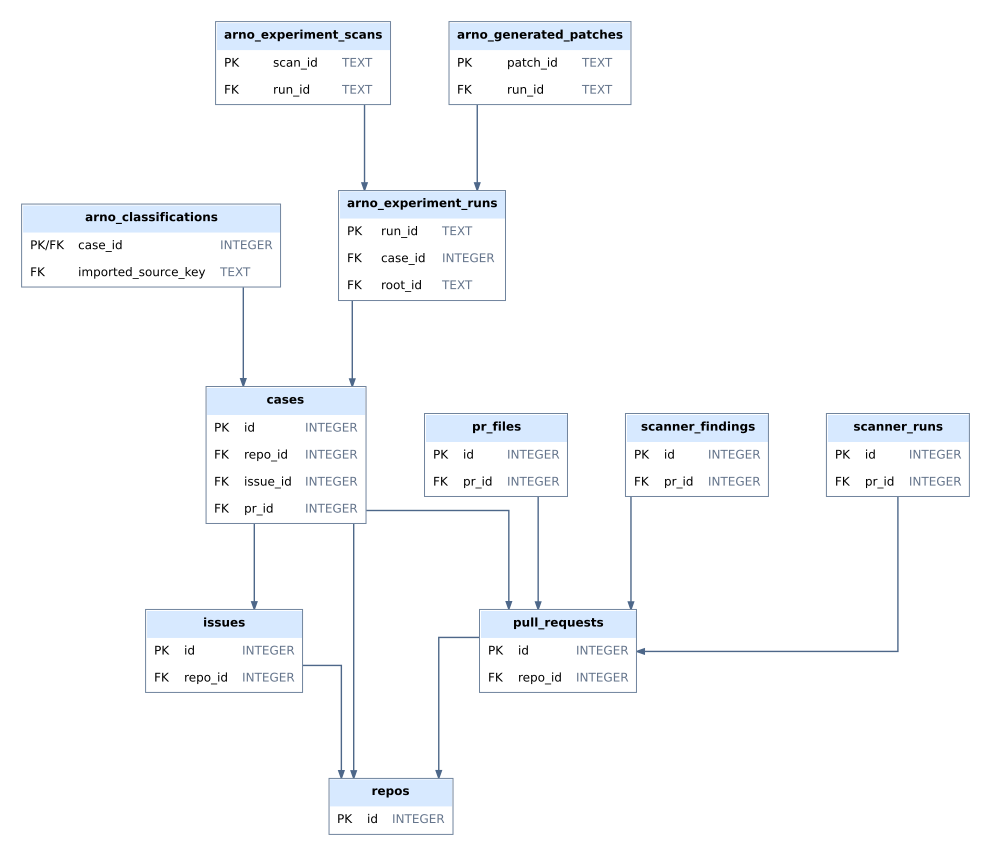

# Database ERDs

[Core overview](erd/OVERVIEW.svg)

[Complete ERD atlas](erd/FULL_DATABASE_ERD.svg)

| Subject | Diagram |
|---|---|
| sqlite internal | [SVG](erd/sqlite_internal.svg) |
| coding lineage | [SVG](erd/coding_lineage.svg) |
| embedded archive | [SVG](erd/embedded_archive.svg) |
| rq1 new70 | [SVG](erd/rq1_new70.svg) |
| provenance audit | [SVG](erd/provenance_audit.svg) |
| mining baseline | [SVG](erd/mining_baseline.svg) |
| rq2 controls statistics | [SVG](erd/rq2_controls_statistics.svg) |
| artifact provenance | [SVG](erd/artifact_provenance.svg) |
| review layer | [SVG](erd/review_layer.svg) |
| rq3 experiments | [SVG](erd/rq3_experiments.svg) |
| rq1 original122 | [SVG](erd/rq1_original122.svg) |

Each table appears once within a diagram; related records connect to the same shared parent. Grey headers mark directly referenced tables from other subjects. All 135 tables and 162 declared FK constraints are covered across the subject diagrams. The overview shows a smaller core subset.

Connectors contain only horizontal and vertical segments. Dense sections may retain crossings between distinct relationships. PK/FK columns and types are shown. Arrows point child to referenced parent, without inferred cardinalities. Composite FKs count as one constraint. Tables without declared relationships remain disconnected. JSON/prose links and historical enforcement are not inferred.
